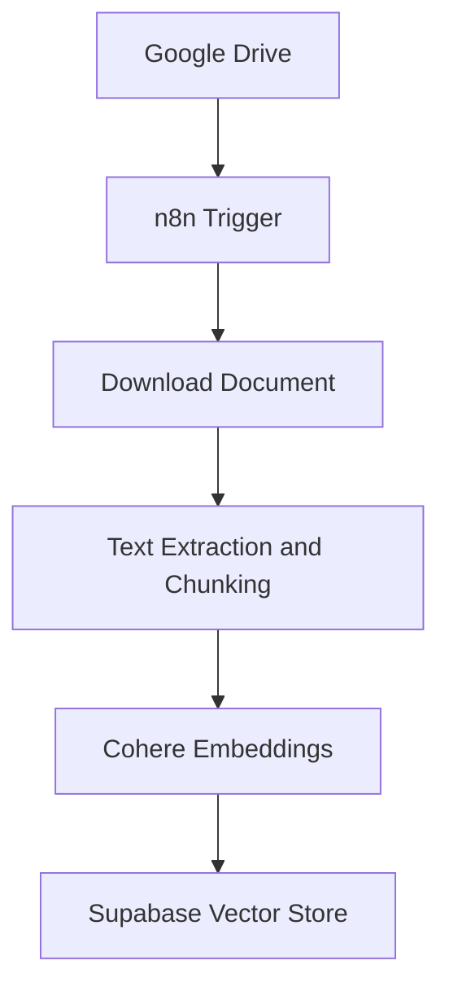
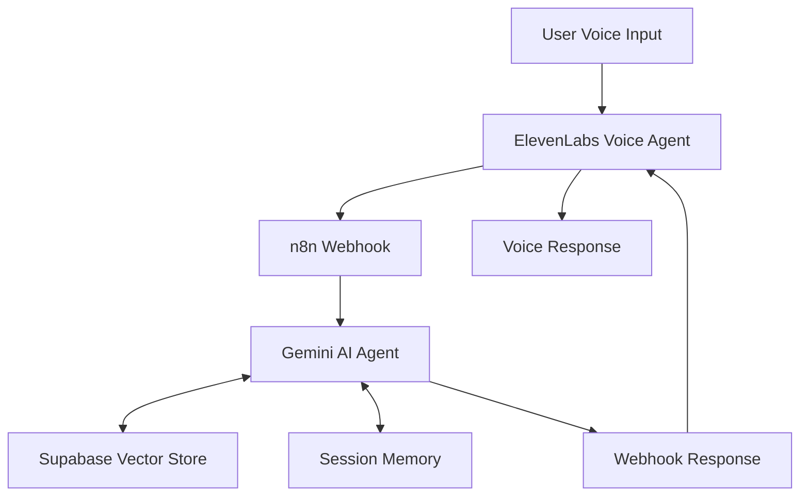

# VoiceRAG-AI

VoiceRAG-AI is a voice-enabled Retrieval-Augmented Generation (RAG) system designed to let users interact with a custom knowledge base through natural voice conversations.

The project combines ElevenLabs Voice AI, n8n workflow orchestration, Google Gemini, Cohere embeddings and Supabase vector search to generate context-aware responses.

## Demo

[Watch the full project demonstration on YouTube](https://youtu.be/DTLtrid8o9g)

## Key Features

- Voice-based interaction through ElevenLabs.
- Automated document ingestion from Google Drive.
- Semantic search using Supabase Vector Store.
- Context-grounded response generation using Google Gemini.
- Session-based conversational memory.
- Webhook-based API integration.
- Modular workflow architecture using n8n.

## Tech Stack

| Technology | Purpose |
|---|---|
| n8n | Workflow orchestration |
| ElevenLabs | Conversational Voice AI |
| Google Gemini | LLM response generation |
| Cohere | Text embeddings |
| Supabase | Vector storage and semantic retrieval |
| Google Drive | Document ingestion |
| Webhooks | API communication |

## System Architecture

### Document Ingestion Pipeline



### Voice RAG Pipeline



## How It Works

### 1. Document Ingestion

The document ingestion workflow automatically monitors a selected Google Drive folder for newly created files.

- Downloads and processes newly detected documents.
- Preserves source filenames as metadata.
- Splits text into 500-character chunks with a 200-character overlap.
- Generates embeddings using Cohere `embed-english-v3.0`.
- Stores document chunks and embeddings in Supabase for semantic retrieval.

### 2. RAG Query Processing

The query workflow exposes a webhook-based API for processing user questions.

- Receives the question and session identifier through a POST request.
- Processes the query using a Gemini-powered AI agent.
- Retrieves relevant document context from Supabase.
- Maintains conversational context using session-based memory.
- Returns the generated response through the webhook.

### 3. Voice AI Integration

ElevenLabs serves as the conversational voice interface. The voice agent can call the n8n query webhook as an external tool, allowing users to interact with the knowledge base through spoken questions and responses.

## Repository Structure

```text
VoiceRAG-AI/
├── workflows/
│   ├── document-ingestion.json
│   └── rag-query.json
└── README.md
```

## Setup and Configuration

### Prerequisites

- n8n instance
- Supabase project
- Cohere API key
- Google Gemini API key
- Google Drive OAuth2 credentials
- ElevenLabs account

### Installation

1. Clone the repository.

```bash
git clone https://github.com/ajmani-x/VoiceRAG-AI.git
cd VoiceRAG-AI
```

2. Import both JSON workflows into n8n.
3. Configure the required API credentials.
4. Select the Google Drive folder for document ingestion.
5. Configure the Supabase `documents` table and compatible vector-search function.
6. Configure and activate the query webhook.
7. Connect the webhook to an ElevenLabs agent as an external tool.
8. Test both workflows before using the voice agent.

## API Reference

The query webhook accepts a POST request with the following JSON body:

```json
{
  "Question": "What does the handbook say about emergency procedures?",
  "sessionId": "conversation-001"
}
```

| Parameter | Description |
|---|---|
| `Question` | User's question |
| `sessionId` | Optional identifier for maintaining conversational memory |

Use a consistent session ID throughout a conversation. If no session ID is provided, the workflow uses `default`.

The response structure depends on the n8n Respond to Webhook node configuration.

## Use Cases

- Voice-enabled knowledge assistants
- Internal company documentation assistants
- Customer support systems
- Interactive educational assistants
- Conversational access to technical manuals

## Project Scope

The current demonstration uses a space station handbook as its knowledge base. The system can be adapted to other domains by updating the document collection and agent system prompt.

The repository contains both n8n backend workflows. The ElevenLabs agent configuration must be set up separately.


